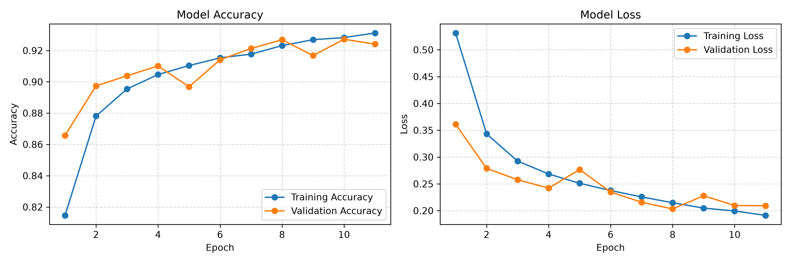
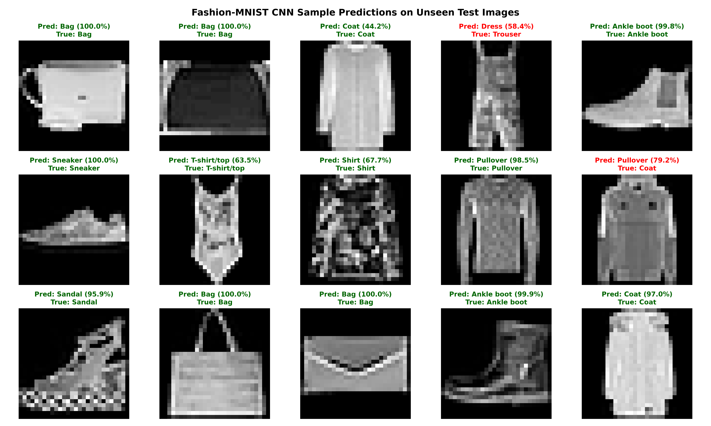

# Fashion Image Classification Using Convolutional Neural Networks (CNN)

A clean, modular deep learning project implementing a Convolutional Neural Network (CNN) using **TensorFlow** and **Keras** to classify clothing items from the **Fashion-MNIST** dataset into 10 distinct categories.

---

## 1. Dataset & Categories

The [Fashion-MNIST](https://github.com/zalandoresearch/fashion-mnist) dataset contains 70,000 28x28 grayscale images (60,000 training, 10,000 testing) across 10 categories:

| Label | Class Name | Label | Class Name |
| :---: | :--- | :---: | :--- |
| **0** | T-shirt/top | **5** | Sandal |
| **1** | Trouser | **6** | Shirt |
| **2** | Pullover | **7** | Sneaker |
| **3** | Dress | **8** | Bag |
| **4** | Coat | **9** | Ankle boot |

---

## 2. Project Structure

The project contains strictly the essential files needed for pipeline clarity and reproducibility:

```text
FashsionCNN/
├── model.py                # CNN model architecture definition
├── train.py                # Dataset loading, preprocessing, model training & history plotting
├── predict.py              # Evaluation and visual prediction on unseen test images
├── requirements.txt        # Minimal required dependencies
├── .gitignore              # Standard Python gitignore
├── README.md               # Project documentation
├── fashion_cnn_model.keras # Saved trained model (generated upon training)
├── training_history.png    # Training & validation accuracy/loss plots (generated upon training)
└── predictions_sample.png  # Prediction grid on unseen test samples (generated upon evaluation)
```

---

## 3. CNN Architecture

The model is built with convolutional and pooling layers designed to capture spatial visual hierarchies:

1. **Convolution Block 1**:
   - `Conv2D(32, (3, 3), activation='relu', padding='same')` + `BatchNormalization()`
   - `Conv2D(32, (3, 3), activation='relu')`
   - `MaxPooling2D(pool_size=(2, 2))`
   - `Dropout(0.25)`
2. **Convolution Block 2**:
   - `Conv2D(64, (3, 3), activation='relu', padding='same')` + `BatchNormalization()`
   - `Conv2D(64, (3, 3), activation='relu')`
   - `MaxPooling2D(pool_size=(2, 2))`
   - `Dropout(0.25)`
3. **Dense Classification Head**:
   - `Flatten()`
   - `Dense(128, activation='relu')` + `BatchNormalization()`
   - `Dropout(0.5)`
   - `Dense(10, activation='softmax')`

---

## 4. Getting Started

### Installation

Install the required packages:

```bash
pip install -r requirements.txt
```

### Training the Model

Run the training pipeline:

```bash
python train.py
```

This will:
- Download and preprocess the Fashion-MNIST dataset.
- Train the CNN with Adam optimizer and early stopping.
- Save the trained weights to `fashion_cnn_model.keras`.
- Save the accuracy & loss curves to `training_history.png`.

### Evaluating & Visualizing Predictions

Run the prediction script to evaluate on unseen test data and generate a sample visualization grid:

```bash
python predict.py
```

This generates `predictions_sample.png`, displaying sample unseen test items with their true labels and predicted categories with confidence percentages.

---

## 5. Results & Visualizations

- **Test Accuracy**: **92.69%**
- **Test Loss**: **0.2033**

### Training History (Loss & Accuracy)


### Sample Predictions on Unseen Test Images


